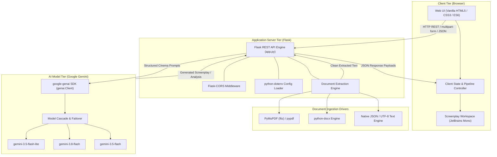
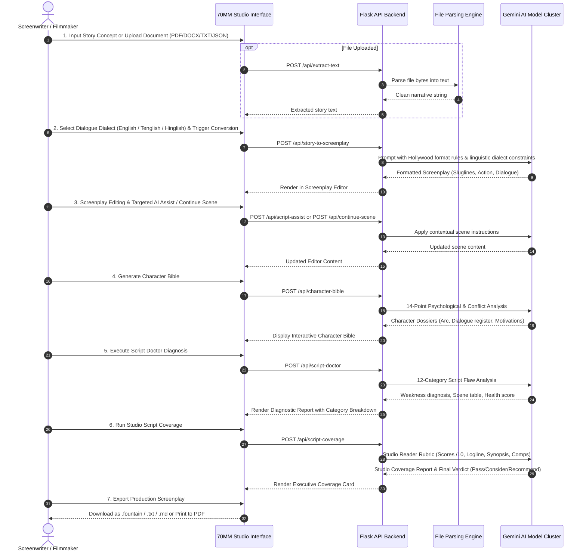
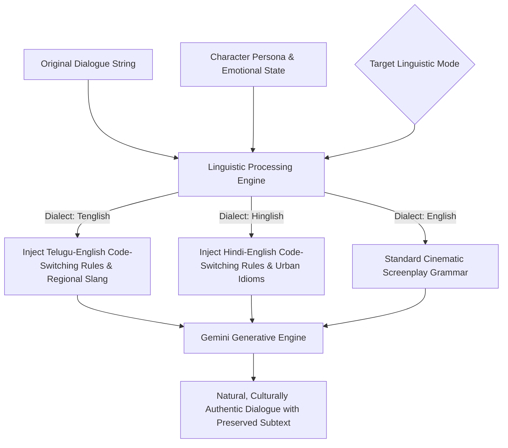

# 70MM AI — Group 2: Script Intelligence Engine

> An advanced, studio-grade screenplay intelligence platform powered by Google Gemini AI. Transform raw concepts and stories into industry-standard Hollywood screenplays, generate comprehensive character bibles, diagnose narrative flaws with a 12-dimension Script Doctor, run studio-level script coverage, and perform culturally authentic dialogue code-switching (Tenglish & Hinglish).

---

## 📋 Table of Contents
1. [Overview](#overview)
2. [Key Features](#key-features)
3. [Technology Stack](#technology-stack)
4. [Architecture & Workflow Diagrams](#architecture--workflow-diagrams)
   - [High-Level System Architecture](#1-high-level-system-architecture)
   - [7-Step Screenplay Intelligence Pipeline](#2-7-step-screenplay-intelligence-pipeline)
   - [Script Doctor 12-Point Diagnostic Flow](#3-script-doctor-12-point-diagnostic-flow)
   - [Dialogue Code-Switching Pipeline](#4-dialogue-code-switching-pipeline)
5. [Project Structure](#project-structure)
6. [Getting Started & Installation](#getting-started--installation)
   - [Prerequisites](#prerequisites)
   - [Installation](#installation)
   - [Environment Configuration](#environment-configuration)
   - [Running the Application](#running-the-application)
7. [API Endpoints Reference](#api-endpoints-reference)
8. [Architectural Rationale & Model Selection](#architectural-rationale--model-selection)
   - [Why Not MuRIL or AI4Bharat Models?](#why-we-do-not-use-muril-or-ai4bharat-models)

---

## 🎬 Overview

As part of the **70MM AI Four-Group Cinematic Architecture**, **Group 2 (Script Intelligence Engine)** bridges the gap between raw narrative concepts (Group 1) and visual pre-visualization (Group 3). 

Writing a production-ready screenplay requires rigid adherence to industry formatting standards (sluglines, action lines, character cues, parentheticals, and transitions), emotional pacing, authentic character dialogue, and multi-act narrative structure. This engine provides professional screenwriters, script consultants, and directors with an end-to-end AI co-pilot.

---

## ✨ Key Features

- **Multi-Format Ingestion**: Upload stories, drafts, and treatments in `.pdf`, `.docx`, `.json`, `.fountain`, `.md`, or `.txt`.
- **Story → Hollywood Screenplay Conversion**: Converts unstructured prose into standardized screenplay format with sluglines (`INT./EXT.`), present-tense action, character headers, and dialogue.
- **Bilingual & Colloquial Code-Switching**:
  - **Standard English**
  - **Tenglish** (Telugu-English natural code-switching with authentic colloquial idioms)
  - **Hinglish** (Hindi-English natural conversational code-switching)
- **Interactive Screenplay Editor & AI Assist**: Live screenplay workspace with automated word/page counting, scene continuation (`Continue Scene`), and targeted prompt-driven revisions.
- **Deep Character Bible Generator**: Creates exhaustive 14-point psychological and dramatic character dossiers (Motivation, Internal/External Conflict, Agency, Flaws, Dialogue Register, Speech Quirks).
- **Character Development Consultant**: Diagnoses character weaknesses and recommends actionable growth arcs, alternative narrative trajectories, and tailored dialogue lines.
- **12-Category Script Doctor**: Systematic screenplay diagnostic evaluating weak scenes, redundant scenes, on-the-nose dialogue, exposition traps, pacing issues, character inconsistencies, plot holes, setup/payoff gaps, weak transitions, repetitive dialogue, unrealistic behaviors, and genre violations.
- **Studio-Grade Script Coverage**: Generates executive production coverage reports featuring logline, synopsis, character breakdown, quantitative category scores (1–10), commercial viability assessment, comp titles, and a definitive decision: **PASS**, **CONSIDER**, or **RECOMMEND**.
- **Multi-Format Export**: One-click export to Plain Text (`.txt`), Markdown (`.md`), Fountain industry standard (`.fountain`), and Print-ready PDF.

---

## 🛠️ Technology Stack

### **Backend Framework & Runtime**
- **Python 3.13+**: Core runtime environment.
- **Flask (v3.1.0)**: Lightweight WSGI web framework and REST API server.
- **Flask-CORS (v6.0.5)**: Cross-Origin Resource Sharing handling.
- **python-dotenv (v1.2.2)**: Secure environment variable management.

### **AI & Large Language Models**
- **Google GenAI SDK (`google-genai` v2.25.0)**: Modern client SDK interfacing directly with Google's Gemini models.
- **Multi-Model Fallback Cascade**: High-availability retry mechanism that cascades across:
  1. `gemini-3.5-flash-lite` (Ultra-fast latency)
  2. `gemini-3.8-flash` (Next-gen reasoning and nuanced creative writing)
  3. `gemini-3.5-flash` (Balanced creative performance and instruction-following)

### **Document Parsing & File Processing**
- **PyMuPDF (`fitz` v1.25.5)**: High-speed PDF text and layout extraction.
- **pypdf**: Secondary stream-based PDF extraction.
- **python-docx**: Microsoft Word `.docx` parsing and paragraph extraction.
- **Native JSON / Text Parsers**: Schema-aware JSON story extraction and plain-text UTF-8 handling.

### **Frontend & User Interface**
- **HTML5**: Semantic document layout with accessible navigation.
- **Vanilla CSS3**:
  - Modern Design Tokens (Curated cinema dark palette: `#0a0a0f`, `#13131f`, `#1c1c2e`).
  - Glassmorphic panels, glowing borders, and gradient highlights.
  - Typography: `Inter` (UI elements), `Playfair Display` (Cinematic headlines), and `JetBrains Mono` (Courier-style screenplay formatting).
  - Micro-animations, responsive two-column split panels, and status indicators.
- **Vanilla JavaScript (ES6+)**:
  - Zero external heavy frontend frameworks (clean, lightning-fast DOM operations).
  - Client-side state management for story inputs, screenplays, and active pipeline stages.
  - Drag-and-drop file ingestion with live progress feedback.
  - Real-time word and page metrics estimation.
  - In-browser export drivers (File blob creation for `.fountain`, `.txt`, `.md`, and print styles).

---

## 📊 Architecture & Workflow Diagrams

### 1. High-Level System Architecture



---

### 2. 7-Step Screenplay Intelligence Pipeline



---

### 3. Script Doctor 12-Point Diagnostic Flow


---

### 4. Dialogue Code-Switching Pipeline



---

## 📁 Project Structure

```
Story_writer/
├── app.py                     # Main Flask backend application & API routing
├── requirements.txt           # Python dependencies
├── run.ps1                    # PowerShell launcher script
├── run.bat                    # Windows Command Prompt batch launcher
├── .env                       # Environment configuration (GEMINI_API_KEY)
├── .gitignore                 # Git ignore specification
├── README.md                  # Comprehensive documentation & architecture guide
├── static/                    # Frontend client assets
│   ├── index.html             # Single-Page Application (SPA) HTML5 structure
│   ├── style.css              # Custom CSS design system, dark mode, typography
│   └── app.js                # Frontend state controller, API client, export drivers
└── venv/                      # Local Python virtual environment
```

---

## 🚀 Getting Started & Installation

### Prerequisites
- **Python 3.10+** (Python 3.13 recommended)
- **Google Gemini API Key** (obtainable from [Google AI Studio](https://aistudio.google.com/))
- **Windows / macOS / Linux**

### Installation

1. **Clone or Navigate to the Repository**:
   ```bash
   cd c:\Users\chaitu_123\OneDrive\Desktop\Story_writer
   ```

2. **Create and Activate Virtual Environment**:
   - **PowerShell:**
     ```powershell
     python -m venv venv
     .\venv\Scripts\Activate.ps1
     ```
   - **Command Prompt (CMD):**
     ```cmd
     python -m venv venv
     venv\Scripts\activate.bat
     ```
   - **macOS / Linux:**
     ```bash
     python3 -m venv venv
     source venv/bin/activate
     ```

3. **Install Dependencies**:
   ```bash
   pip install -r requirements.txt
   ```

### Environment Configuration

Create or edit the `.env` file in the project root:
```env
GEMINI_API_KEY=AIzaSy...your_actual_api_key_here
```
*(Note: You can also enter the API key directly through the web UI header modal if preferred.)*

### Running the Application

#### **Method 1: One-Click Scripts**
- **PowerShell**:
  ```powershell
  .\run.ps1
  ```
- **Command Prompt**:
  ```cmd
  run.bat
  ```

#### **Method 2: Direct Command**
```powershell
.\venv\Scripts\python.exe app.py
```

Once started, open your web browser and navigate to:
```
http://localhost:5000
```

---

## 🔌 API Endpoints Reference

| Endpoint | Method | Description | Payload / Parameters |
| :--- | :--- | :--- | :--- |
| `/` | `GET` | Serves the main SPA frontend (`index.html`) | None |
| `/api/env-key` | `GET` | Checks if `GEMINI_API_KEY` is configured in `.env` | None |
| `/api/test-key` | `POST` | Validates a provided Gemini API key | `{ "api_key": "..." }` |
| `/api/extract-text` | `POST` | Extracts text from uploaded PDF, DOCX, TXT, JSON, MD, FOUNTAIN | Multipart form: `file` |
| `/api/story-to-screenplay`| `POST` | Converts story narrative to Hollywood screenplay | `{ "story": "...", "language": "English\|Tenglish\|Hinglish", "api_key": "..." }` |
| `/api/script-assist` | `POST` | Applies targeted edits or polish to a screenplay | `{ "screenplay": "...", "instruction": "...", "language": "...", "api_key": "..." }` |
| `/api/language-convert`| `POST` | Converts dialogue to authentic code-switched dialect | `{ "dialogue": "...", "target_lang": "...", "character_name": "...", "personality": "..." }` |
| `/api/character-bible` | `POST` | Generates exhaustive 14-point character profiles | `{ "content": "...", "api_key": "..." }` |
| `/api/character-develop`| `POST`| Deep psychological character development analysis | `{ "character_name": "...", "character_description": "...", "story_context": "..." }` |
| `/api/script-doctor` | `POST` | Diagnoses script flaws across 12 dramatic categories | `{ "screenplay": "...", "api_key": "..." }` |
| `/api/script-coverage` | `POST` | Generates studio coverage report with rubric scores | `{ "screenplay": "...", "api_key": "..." }` |
| `/api/continue-scene` | `POST` | Extends screenplay seamlessly from the final scene | `{ "screenplay": "...", "language": "...", "api_key": "..." }` |

---

## 🏛️ Architectural Rationale & Model Selection

### Why We Do Not Use MuRIL or AI4Bharat Models

In developing the **70MM AI Script Intelligence Engine**, an in-depth evaluation was conducted regarding regional NLP and Indian language models, specifically **Google's MuRIL (Multilingual Representations for Indian Languages)** and **AI4Bharat models (IndicBERT, IndicTrans2, IndicBART)**. 

While these models are remarkable research milestones for academic Indic NLP, they were deliberately rejected in favor of modern instruction-tuned Generative Large Language Models (**Google Gemini**). The technical justifications are detailed in the architectural commentary below:

<!-- =========================================================================================
     ARCHITECTURAL COMMENTARY: WHY NOT MURIL OR AI4BHARAT FOR 70MM SCRIPT INTELLIGENCE?
     =========================================================================================

1. ARCHITECTURAL MISMATCH: ENCODER (BERT) VS. AUTOREGRESSIVE GENERATIVE LLM
   - MuRIL and IndicBERT are strictly BERT-based Masked Language Models (Encoders). They are 
     engineered exclusively for extractive tasks: Named Entity Recognition (NER), sequence 
     classification, sentiment analysis, extractive QA, and semantic embeddings.
   - They CANNOT perform autoregressive, open-ended creative text generation. They cannot generate 
     sluglines, write dynamic dialogue exchanges, compose multi-page screenplays, or extrapolate 
     narrative plot beats.
   - Using MuRIL to write a screenplay is architecturally impossible without an external decoder, 
     and even then, encoder-decoder models of that vintage lack generative fluency.

2. CONTEXT WINDOW BOTTLENECKS
   - MuRIL and IndicBERT have a hard sequence-length limit of 512 tokens (~350 to 400 words).
   - IndicTrans2 and IndicBART typically max out between 1,024 and 2,048 tokens.
   - A single screenplay scene frequently exceeds 1,000 tokens, and full scripts or acts span 
     15,000 to 30,000+ tokens.
   - Deep cinematic features like the "Script Doctor" (diagnosing setup/payoffs across scenes) and 
     "Script Coverage" (analyzing three-act story arcs) require holistic comprehension of long documents. 
   - Google Gemini features context windows of up to 1,000,000+ tokens, allowing complete scripts 
     to be evaluated without catastrophic truncation.

3. COLLOQUIAL CODE-SWITCHING (TENGLISH & HINGLISH) VS. FORMAL SCRIPT TRANSLATION
   - AI4Bharat models (such as IndicTrans2) are purpose-built for formal cross-lingual machine translation 
     between native Indian scripts (e.g., formal Telugu script to formal Devanagari Hindi or English). 
     Their training corpora draw from government portals (Samantar), Wikipedia, and news feeds.
   - Contemporary cinematic dialogue NEVER uses stiff, formal textbook prose. It relies entirely on 
     informal, romanized, colloquial code-switching (e.g., Tenglish: "Nuvvu last night ekkada unnava? 
     Vadiki phone chesi warning ivvu!").
   - Machine translation models attempt to translate word-by-word into native scripts, destroying the 
     rhythm, urban slang, and pop-culture subtext.
   - In contrast, frontier LLMs like Gemini 3.5/3.8 Flash are pre-trained on massive, conversational web 
     and media datasets, giving them a native grasp of Latin-script transliterated code-switching, 
     conversational cadences, and regional idioms.

4. LACK OF INDUSTRY SCREENPLAY FORMATTING & STRUCTURAL SYNTAX
   - Screenplay composition requires strict adherence to typographical and syntactic conventions:
     all-caps scene headings (INT./EXT.), present-tense action blocks, centered character names, 
     parenthetical direction, dialogue indentations, and transition cues (CUT TO:, FADE OUT).
   - Indic NLP models have zero pre-training or fine-tuning on Hollywood standard or Fountain 
     screenplay syntax.
   - Gemini models have absorbed millions of scripts, film critiques, and screenwriting treatises, 
     enabling immediate zero-shot and few-shot formatting adherence.

5. COMPLEX INSTRUCTION FOLLOWING & MULTI-STEP REASONING
   - Features like the Script Doctor evaluate 12 distinct, nuanced creative dimensions (e.g., 
     identifying on-the-nose exposition, analyzing whether a character has proactive agency or is 
     purely reactive, and pinpointing unresolved plot threads).
   - This requires high-level chain-of-thought reasoning, creative empathy, and deductive analysis. 
     Translation and BERT models possess zero reasoning capacity for dramatic theory or story doctoring.

6. INFRASTRUCTURE COMPLEXITY, GPU HOSTING, AND LATENCY OVERHEAD
   - Self-hosting IndicTrans2 (1B/3B parameters) or IndicBART requires dedicated NVIDIA GPUs (VRAM, 
     CUDA drivers, PyTorch, Triton/vLLM server management), resulting in significant operational 
     expenses, scaling bottlenecks, and high maintenance.
   - The Gemini API delivers serverless, high-throughput, managed infrastructure with built-in model 
     fallback cascade (Lite -> Flash -> Pro), achieving sub-second response times for edits with 
     zero local GPU hardware dependencies.

SUMMARY:
MuRIL and AI4Bharat models are exceptional for formal Indian-language classification and document 
translation. However, for a generative cinematic screenplay studio requiring long-context reasoning, 
strict screenplay formatting, deep dramatic critique, and natural romanized code-switching, 
modern generative frontier LLMs (Gemini) are the technically superior and appropriate choice.
========================================================================================= -->

### Quick Comparison Matrix

| Capability / Requirement | MuRIL (Google) | AI4Bharat (IndicTrans2 / IndicBERT) | Google Gemini (3.5 / 3.8 Flash) |
| :--- | :---: | :---: | :---: |
| **Model Family** | Encoder (BERT-base) | Encoder (BERT) / Seq2Seq (MT) | Decoder Autoregressive LLM |
| **Primary Task** | Embeddings / NER / Classification | Machine Translation / Native Script | Generative Writing & Complex Reasoning |
| **Generative Story Writing** | ❌ Impossible | ❌ Incapable of creative writing | ✅ Industry-standard Hollywood formatting |
| **Max Context Window** | 512 tokens | 1,024 – 2,048 tokens | **1,000,000+ tokens** |
| **Colloquial Code-Switching (Tenglish/Hinglish)**| ❌ Native script focused | ❌ Formal translation only | ✅ Natural romanized slang & cadences |
| **Dramatic Script Doctoring (12 Dimensions)** | ❌ No reasoning capabilities | ❌ No reasoning capabilities | ✅ Advanced creative dramatic diagnosis |
| **Studio Coverage & Scoring** | ❌ No | ❌ No | ✅ Comprehensive industry rubric analysis |
| **Hosting & Infrastructure** | Dedicated GPU server required | Dedicated GPU server required | Managed, serverless API with zero local VRAM |

---

## 👥 Contributors & Acknowledgements
- **70MM AI — Group 2**: Script Intelligence Engine Development Team
- **Powered by**: Google Gemini API & DeepMind generative technologies.
